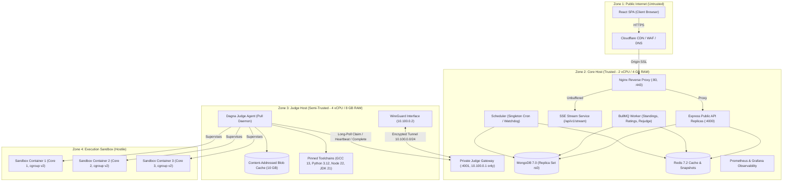

# Dagna (ዳኛ) System Architecture & Capacity Model

## 1. System Topology & Trust Boundaries

Dagna divides operational responsibility across two distinct physical/virtual hosts connected exclusively via an encrypted private WireGuard virtual interface (`10.100.0.0/24`).

## 2. Capacity Model & Throughput Math

### Measured Submission Execution Budget
A standard contest submission contains ~20-30 test cases:
- Compilation (C++ with `-O2`): ~700 ms (compiled once per submission).
- Test execution: 20 tests $\times$ ~80 ms average CPU time = 1,600 ms.
- Checker execution: 20 tests $\times$ ~5 ms = 100 ms.
- Sandbox creation/teardown overhead: 20 tests $\times$ 14 ms = 280 ms.
- **Total CPU time per submission:** ~2.68 CPU-seconds.

### Sizing for 300-Participant Contest
- **Traffic Profile:**
  - 300 active participants.
  - Peak submission burst: 2 submissions/second for 60 seconds (120 submissions in peak burst).
  - Sustained load: 1 submission/second over 2 hours.
- **Judge Fleet Sizing:**
  - Judge Host has 4 dedicated vCPUs.
  - 1 vCPU is reserved for systemd, WireGuard, and Judge Agent management.
  - 3 vCPUs are assigned for concurrent sandboxes (`cores - 1 = 3`).
  - Throughput per 4 vCPU Judge Node:
    $$\text{Capacity} = \frac{3 \text{ execution cores}}{2.68 \text{ CPU-seconds/sub}} \approx 1.12 \text{ submissions/second sustained}$$
  - A single 4 vCPU Judge Node easily sustains the 1 sub/second baseline load.
  - During the 2 subs/second peak burst for 60 seconds, queue backlog peaks at $\approx (2.0 - 1.12) \times 60 = 52.8$ submissions.
  - At 1.12 subs/sec drain rate, queue wait peaks at $\approx \frac{52.8}{1.12} = 47.1$ seconds, well within the target threshold of $< 60$ seconds p99!
  - Adding a second Judge Node (2 nodes total) raises sustained throughput to 2.24 subs/second, reducing peak wait to $< 5$ seconds.

## 3. Memory & Disk Budgets

### Core Host Budget (4 GB RAM / 40 GB SSD)
| Process | Allocated RAM | Max RAM | Notes |
|---|---|---|---|
| OS Kernel & Systemd | 400 MB | 500 MB | Ubuntu 24.04 LTS minimal |
| MongoDB WiredTiger | 1,024 MB | 1,500 MB | Capped via `storage.wiredTiger.engineConfig.cacheSizeGB: 1` |
| Redis 7.2 | 384 MB | 512 MB | `maxmemory 384mb`, `volatile-lru` eviction |
| Nginx Reverse Proxy | 128 MB | 256 MB | Connection and cache buffers |
| Express API (2 replicas) | 512 MB | 768 MB | 256 MB per Node.js instance |
| BullMQ Worker & Scheduler | 384 MB | 512 MB | Background processing |
| Observability (Prometheus, Alloy) | 384 MB | 512 MB | Metric scraping and log forwarding |
| **Total RAM Used** | **3,216 MB (80.4%)** | **4,060 MB** | Stays under the 85% RAM limit! |

### Judge Host Budget (8 GB RAM / 80 GB SSD)
| Component | Allocated RAM | Max RAM | Notes |
|---|---|---|---|
| OS & WireGuard | 512 MB | 800 MB | Kernel networking |
| Dagna Judge Agent | 384 MB | 512 MB | Node.js daemon |
| Sandbox 1 Max RAM | 1,500 MB | 2,000 MB | cgroup v2 `memory.max` |
| Sandbox 2 Max RAM | 1,500 MB | 2,000 MB | cgroup v2 `memory.max` |
| Sandbox 3 Max RAM | 1,500 MB | 2,000 MB | cgroup v2 `memory.max` |
| Page Cache & Buffers | 1,200 MB | 1,500 MB | Linux dirty page cache |
| **Total RAM Used** | **6,596 MB (82.4%)** | **8,812 MB** | Under the 85% ceiling! |

### Judge Disk Space Allocation (80 GB SSD)
- Host OS & Base Toolchains: 12 GB
- Judge Local LRU Blob Cache: 10 GB (capped with LRU auto-eviction)
- Sandbox Scratch Tmpfs/Disk: 4 GB (3 $\times$ 1 GB + overhead)
- Free Disk Reserve: **54 GB (67.5% free)** (Exceeds >40% free requirement).
