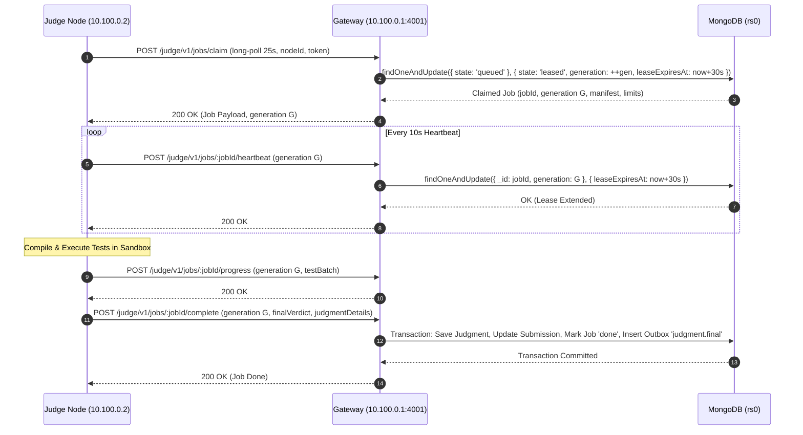

# Dagna (ዳኛ) Judge Gateway & Fleet Protocol

**Protocol Version:** `DAGNA-PROTOCOL-v1`

## 1. Sequence & Lease Fencing Flow

## 2. Fencing Token Rejection (Zombie Node Handling)

If a judge node is paused or delayed by a network blip exceeding 30s:
1. Core Host scheduler sweep detects `state: 'leased' AND leaseExpiresAt < now`.
2. Scheduler increments `attempt = attempt + 1`, resets `state = 'queued'`, and clears `leaseOwner`.
3. Another judge node claims the job with generation `G + 1`.
4. If the zombie node awakens and attempts to complete with generation `G`:
   - Gateway verifies `current.generation === payload.generation`.
   - Generation mismatch occurs (`G != G + 1`).
   - Gateway immediately responds with `409 Conflict: Stale generation token`.
   - Zombie node immediately kills active sandbox and drops cached state.
   - Result: Exactly-once verdict guarantee; zero corrupted or duplicate scoreboards.
